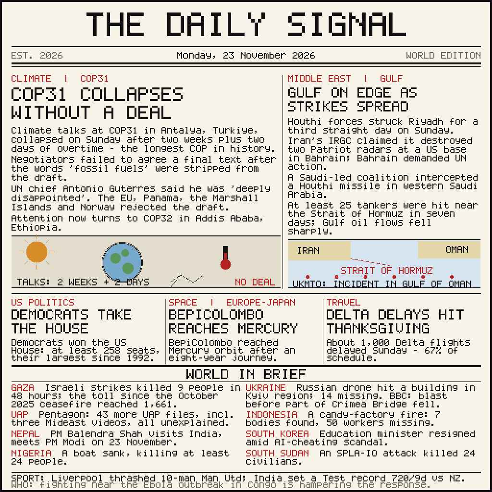

# 23 November 2026 in One Image



A one-page newspaper front page — **THE DAILY SIGNAL**, Monday, 23 November
2026 — drawn entirely by `main.py` in pure Python 3 standard library. No
Pillow, no system fonts, no network access at run time.

## How it works

- `main.py` builds a 1024×1024 RGB canvas in memory and renders everything
  with its own drawing primitives (rectangles, lines, circles).
- Text uses a built-in 5×7 bitmap font (A–Z, a–z, 0–9 and punctuation),
  scaled 2×–7× for body text, headlines and the masthead.
- The PNG is written by a small built-in encoder (zlib compression, filter
  type 0) — no image library needed.
- The two illustrations are procedural: the COP31 panel (sun, globe,
  thermometer, cracked earth) and the Gulf panel (schematic map of the
  Strait of Hormuz with attacked-tanker markers) are drawn by code.
- Output is deterministic: two runs produce byte-identical PNGs.

## Run

```sh
MAKEFUN_OUTPUT_DIR=out python3 main.py   # writes out/entry.png
```

Without `MAKEFUN_OUTPUT_DIR` the image is written to `/output/entry.png`.
The PNG is 1024×1024 and well under the 1 MiB limit.

## Stories on the page

- **Lead — COP31 collapses:** climate talks in Antalya, Turkiye, ended
  on Sunday 22 November with no deal after two weeks plus two days of
  overtime, the longest COP in history. The words "fossil fuels" were
  stripped from the draft; UN chief Antonio Guterres said he was "deeply
  disappointed"; the EU, Panama, the Marshall Islands and Norway rejected
  the draft. Attention now turns to COP32 in Addis Ababa, Ethiopia.
- **Gulf on edge:** Houthi forces struck Riyadh for a third straight day;
  Iran's IRGC claimed it destroyed two Patriot radars at a US base in
  Bahrain; Bahrain demanded UN action; a Saudi-led coalition intercepted a
  Houthi missile in western Saudi Arabia; at least 25 tankers were hit
  near the Strait of Hormuz in seven days and Gulf oil flows fell sharply;
  UKMTO reported a tanker incident in the Gulf of Oman.
- **Democrats take the House:** at least 258 seats, their largest since
  1992.
- **BepiColombo reaches Mercury:** the European-Japanese probe entered
  Mercury orbit after an eight-year journey.
- **Delta delays hit Thanksgiving:** about 1,000 flights delayed on
  Sunday, 67% of the schedule.
- **World in Brief:** Gaza (9 killed in 48 hours; toll since the October
  2025 ceasefire 1,661); Ukraine (Russian drone hit a building in the
  Kyiv region, 14 missing; BBC: blast before part of the Crimea Bridge
  fell); Pentagon's 43 more secret UAP files; Indonesia candy-factory
  fire (7 bodies found, 50 workers missing); Nepal PM Balendra Shah
  visits India; South Korea education minister resigns amid an
  AI-cheating scandal; Nigeria boat sinking (at least 24 killed);
  South Sudan SPLA-IO attack (24 civilians killed).
- **Footer:** Liverpool thrashed 10-man Man Utd; India set a Test record
  720/9d vs New Zealand; WHO: fighting near the Ebola outbreak in Congo
  is hampering the response.

All facts were verified against Reuters, AP, UN News, CNN and Arab News
reporting on the morning of 23 November 2026.

## License

MIT — see `LICENSE`.
